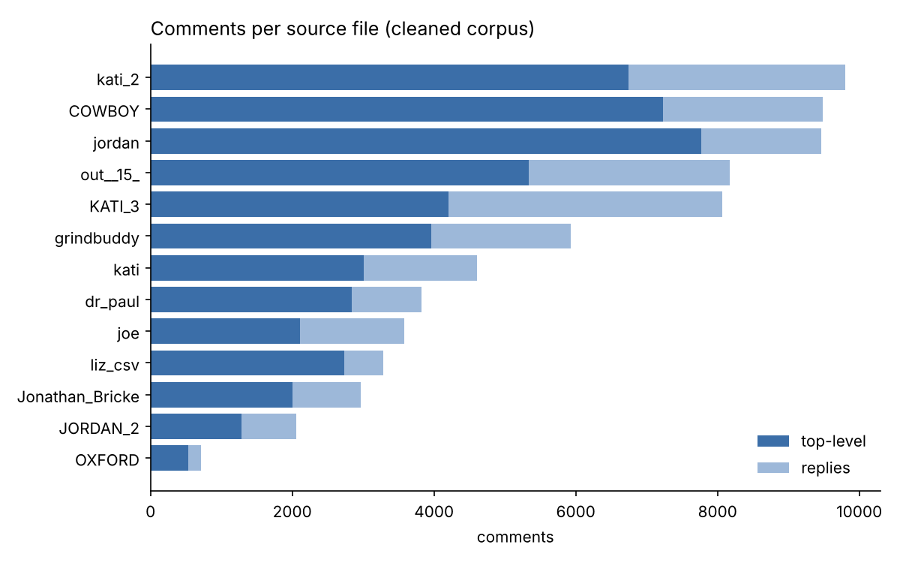
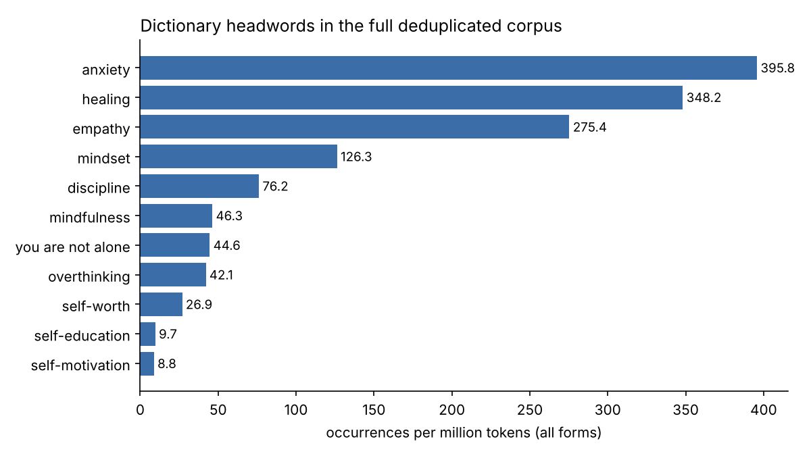

# MindWords — a corpus-based dictionary of mental health discourse on YouTube


 

A specialised English corpus built from the comment sections of 14 YouTube videos on mental health and self-improvement, and a learner's dictionary derived from it. Course project, *Computational Linguistics 2025/26* (EMLex), by **Adelya Aibolova, Souhaila Derbal and Salah Eddine Nacer Benkhemis**.

**📖 Open the dictionary: [adelyaaibolova.github.io/mindwords-corpus](https://adelyaaibolova.github.io/mindwords-corpus/)**

> **Research question.** Which lexical units characterise mental-health and self-improvement discourse on YouTube, and how does a lay audience actually use them in spontaneous online writing?

## Highlights

| | |
|---|---|
| **Raw collection** | 120,826 comments from 14 videos (TEDx talks, podcasts, mental-health educators, motivational speakers, influencers) |
| **After language filter** | 79,646 comments from 14 files |
| **After cleaning** | 71,932 comments from 13 videos (49,747 top-level, 22,185 replies), ≈ 2.2 M word tokens |
| **Sketch Engine corpus** | two-video subcorpus, 623,452 tokens |
| **Dictionary** | 11 entries in 5 domains, with corpus examples, collocations and translations into Arabic, German, French and Spanish |

### Findings in brief

- **Self-directed *empathy*.** In standard English empathy is aimed at others; in the corpus it is overwhelmingly reflexive — *give yourself empathy and speak up*, *I was not showing myself empathy* — i.e. a synonym for self-compassion.
- ***Discipline* as liberation.** The Visual Word Sketch for *discipline is a …* yields *gateway, engine, freedom*, plus the bodily metaphor *discipline muscle*. In the reference corpus (English Web 2021) the same word is institutional: *academic, fiscal, strict*; *impose, enforce, instill*.
- ***Anxiety* is clinical, *healing* is spiritual.** Word Sketch Difference shows *anxiety* with varied clinical modifiers (*social, debilitating, constant*) and compounds (*anxiety disorder/attack*), whereas *healing* takes only *spiritual* and combines with *art, medicine, herb, frequency*. A counter-narrative also appears: *Anxiety is not an enemy*.
- **Creative compounding.** A CQP query `[pos="N.*"][word="anxiety"]` surfaces *separation, job, death, shame anxiety* and the coinage *trickle-down anxiety*.
- **Productive *self-*.** *self-education, self-discipline, self-worth, self-motivation, self-hate* — all keyword-level, all tied to personal responsibility.
- **Comment sections are multilingual.** Arabic, Portuguese, Dutch and Spanish tokens reached the keyword list even after filtering.

The full write-up (German) is in [`report/Forschungsbericht_MindWords_de.md`](report/Forschungsbericht_MindWords_de.md).

## The dictionary

All 11 entries — definition, four or five authentic examples with the video they come from, common word groups, a usage note, translations into Arabic, German, French and Spanish, and most with a quote — are on the [dictionary page](https://adelyaaibolova.github.io/mindwords-corpus/), searchable by headword, word group or translation.

The page keeps the design made in the project ([`dictionary/template.html`](dictionary/template.html)); the content lives in [`dictionary/entries.json`](dictionary/entries.json):

```bash
python scripts/build_dictionary.py   # entries.json + template.html -> docs/index.html
python scripts/build_dictionary.py --verify data/raw/corpus_clean.csv   # fails if an example is not in the corpus
```

When the repository was prepared, the examples and word groups were checked against the corpus. Most examples on the original page could not be found verbatim in the comments, so they were replaced: every example now occurs word for word in the cleaned corpus (shown with the video it comes from), and every word group is attested there. Examples from spam comments (e.g. ads for self-help books mentioning *self-worth* or *mindset*) were excluded. Definitions are written for the dictionary and linked to the reference dictionary they were checked against; translations link to Almaany, DWDS/Duden, Le Robert and RAE.

## Corpus



The 14 videos and their files are listed in [`data/videos.csv`](data/videos.csv). Descriptive statistics per file are in [`data/derived/source_stats.csv`](data/derived/source_stats.csv).



### Cleaning

[`scripts/clean_comments.py`](scripts/clean_comments.py) turns the language-filtered file (79,646 comments) into the analysis corpus (**71,932 comments, ≈ 2.2 M tokens**). Every step is logged in [`data/derived/cleaning_log.csv`](data/derived/cleaning_log.csv):

| Step | What it does | Comments affected |
|---|---|---:|
| HTML | timestamp and emoji links dropped, `<br>` → space, tags stripped, `&#39;` → `'` | 9,180 changed |
| invisible characters | zero-width spaces, bidi marks | 1,109 changed |
| URLs | `http(s)://…`, `www.…` | 159 changed |
| video timestamps | `1:35:55`, leading `3:00 …`, `at 16:10`, `@6:35` — but not *Heb 9:27* or *5:30 am* | 1,016 changed |
| reply mentions | `@username` (noise and personal data) | 5,101 changed |
| no letters left | emoji-only or timestamp-only comments | 1,871 removed |
| duplicate source file | `Huberman_Lab.csv` = `dr_paul.csv` | 3,865 removed |
| exact duplicates | same text, date and time within one video | 376 removed |
| repeated texts | creator template replies and spam bots, posted ≥ 5× per video (first copy kept) | 1,602 removed |

The function-level behaviour is covered by unit tests in [`tests/`](tests/test_textclean.py) (`python -m pytest`).

> This cleaning pipeline was written after the course project, when the repository was prepared. The Sketch Engine analyses in the report were run on the earlier, lightly cleaned two-video corpus, so they still contain some of the noise described below.

### Data quality findings

- **Creator replies made up half of one video.** Frederik Imbo answered ~1,400 comments with a handful of templates (*"Thank you for both watching my TEDx talk and sending me this kind message…"*). Removing them cuts that video from 344k to 164k tokens. This is the likely reason why *message* and *Fredrick* show up in the report's keyword list.
- **Spam bots.** Near-identical ads for a manifestation book and an "investment manager" recur in the GrindBuddy and Joe Dispenza comments — which inflates *manifest* and explains the odd keyword *eva*. Recurring texts are listed in [`data/derived/repeated_texts.csv`](data/derived/repeated_texts.csv).
- **HTML only in replies.** The original collection script ([`scripts/original/colab_collect_comments.py`](scripts/original/colab_collect_comments.py)) asked for plain text for top-level comments but not for replies, so the API returned replies as HTML: all 8,618 comments with `&#39;` or `<br>` are replies. The new [`collect_comments.py`](scripts/collect_comments.py) and the cleaning step handle this.
- **One video was downloaded twice** (Paul Conti on the Huberman Lab channel, 3,980 comments in two files).
- **Single videos still dominate some headwords:** e.g. most *empathy/empathic* hits come from one Kati Morton video (*Are You a Narcissist?*). See [`headword_by_source.csv`](data/derived/headword_by_source.csv).

### Why the raw comments are not in this repository

The comment texts are user-generated content obtained under the YouTube API Terms of Service, which restrict redistribution. The repository therefore ships the **code to rebuild the corpus** and **aggregate data** (frequencies, per-source statistics), not the comments themselves. See [`data/README.md`](data/README.md).

## Reproducing the corpus

```bash
git clone https://github.com/Adelyaaibolova/mindwords-corpus.git
cd mindwords-corpus
pip install -r requirements.txt
cp .env.example .env          # then put your own YouTube Data API key in .env

# 1. collect comments (fill in video_id in data/videos.csv first)
python scripts/collect_comments.py --video-list data/videos.csv --out-dir data/raw/

# 2. combine the per-video files, drop Arabic-script comments (--langdetect also drops other languages)
python scripts/filter_and_combine.py --in-dir data/raw --out data/raw/combined_filtered.csv

# 3. clean: HTML, URLs, mentions, timestamps, empty comments, duplicates, template replies and spam
python scripts/clean_comments.py data/raw/combined_filtered.csv data/raw/corpus_clean.csv \
       --log data/derived/cleaning_log.csv --repeats-out data/derived/repeated_texts.csv

# 4. descriptive statistics and figures -> data/derived/
python scripts/corpus_stats.py data/raw/corpus_clean.csv --out data/derived

# 5. export for Sketch Engine / CQPweb (one <doc> per comment with metadata)
python scripts/export_sketchengine.py data/raw/corpus_clean.csv corpus.txt
python scripts/export_sketchengine.py data/raw/corpus_clean.csv subset.txt --sources out__15_.csv jordan.csv   # any subset of files
```

The exported file can be uploaded to Sketch Engine as plain text; the `<doc>` attributes (`source`, `type`, `likes`, `year`) become text types for building subcorpora — which also makes it easy to address the imbalance noted above.

## Methods

| Tool | Used for |
|---|---|
| Sketch Engine — Keywords | candidate selection against English Web 2021 |
| Word Sketch / Visual Word Sketch | collocational profiles, metaphors (*discipline*, *self-education*, *anxiety*) |
| Word Sketch Difference | *anxiety* vs *healing* |
| Concordance (GDEX-sorted) + distribution | dictionary examples, self-directed *empathy* |
| Thesaurus | near-synonyms of *mindset* |
| CQPweb | POS query for noun + *anxiety* compounds |

## Repository structure

```
mindwords-corpus/
├── README.md
├── data/
│   ├── README.md               # what is and isn't included, column schema
│   ├── videos.csv              # the 14 source videos
│   ├── raw/                    # local only, git-ignored
│   └── derived/                # shareable statistics + figures
├── dictionary/
│   ├── entries.json            # the 11 dictionary entries
│   └── template.html           # page design
├── docs/
│   └── index.html              # built dictionary page, served by GitHub Pages
├── report/
│   └── Forschungsbericht_MindWords_de.md
├── scripts/
│   ├── collect_comments.py     # YouTube Data API v3 -> CSV
│   ├── filter_and_combine.py   # merge per-video files, language filter
│   ├── clean_comments.py       # cleaning pipeline with step log
│   ├── textclean.py            # cleaning functions
│   ├── corpus_stats.py         # statistics + figures
│   ├── build_dictionary.py     # entries.json -> docs/index.html
│   ├── export_sketchengine.py  # Sketch Engine / CQPweb text export
│   └── original/
│       └── colab_collect_comments.py   # script used in the project (key removed)
├── tests/
│   └── test_textclean.py
├── requirements.txt
├── .env.example
├── CITATION.cff
└── LICENSE
```

## Limitations

- **Imbalance.** Only two of the 14 videos went into the Sketch Engine corpus, so individual videos dominate some patterns (visible in the distribution of *empathy*).
- **Language filtering** happened after collection and only targeted Arabic script; other languages remain in small numbers.
- **API artefacts** (numbers, timestamps) appear in some concordance lines of the report's corpus; `clean_comments.py` now removes them.
- Frequencies in `data/derived/` are computed with a simple regex tokenizer over the cleaned corpus (all 13 videos) and are not directly comparable with Sketch Engine figures for the two-video subcorpus.

## Authors

- Adelya Aibolova — [@Adelyaaibolova](https://github.com/Adelyaaibolova)
- Souhaila Derbal
- Salah Eddine Nacer Benkhemis

## License

Code: [MIT](LICENSE). Report, dictionary entries and derived data: [CC BY 4.0](https://creativecommons.org/licenses/by/4.0/). YouTube comment texts remain the property of their authors and are not distributed here.

If you use this work, please cite it via [`CITATION.cff`](CITATION.cff).
